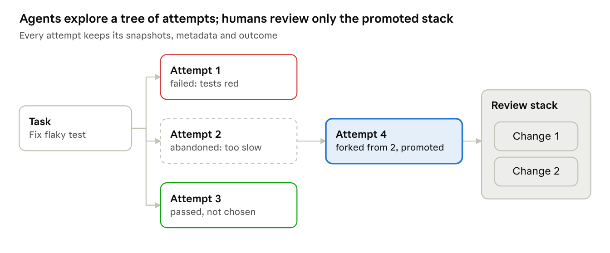
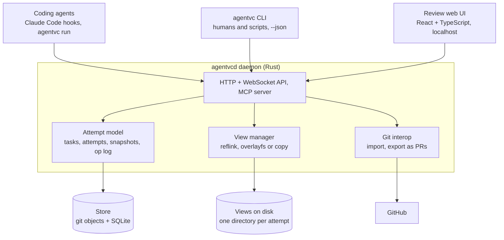

# Agent-First Version Control — Design Doc v2

Nov 25, 2026 · Yury Kirpichev · Living version: [Claude Doc](https://claude.ai/artifact/DzNJbFfuaz4tj3xMoLBpQU)

## Summary

We are building a version control layer where the **tree of agent attempts** is the main structure, every attempt runs in a **cheap copy-on-write view that shares builds and dependencies**, and a **review UI** turns that tree into something a human can steer and approve in minutes. Git and GitHub stay at the edges, for import and for shipping PRs.

**Positioning.** Running several agents in parallel is no longer novel: GitButler, jj workspaces and Lit all cover it in some form. What nobody combines is (1) failed and competing attempts kept as first-class, queryable history, (2) isolated views that fork in milliseconds without a fresh install or build, and (3) a review surface built around choosing between attempts rather than reading one diff. That combination is the product.

**Who it is for first.** A solo developer or small team running 3 to 20 coding agents a day on one machine, who today juggles worktrees, re-installs dependencies per agent, and reviews agent PRs one by one on GitHub.

Status: v2 draft. Changes from v1: corrected prior art, sharper positioning, a full section on the review UI, an architecture and tech stack, and a phased plan with an MVP.

## Problem

Git, GitHub and today's build tools assume one human telling one linear story. Agents run a search instead: they try an idea, test it, back off, and run several alternatives at once.

- **The search is lost or pollutes history.** Throwaway worktrees and branches discard failed attempts, or bury reviewers in WIP commits. The next agent repeats the same dead ends.
- **Parallel agents are expensive.** Each worktree, clone or jj workspace is a full checkout with its own dependency install and build, so ten agents cost ten environments. A shared working tree (GitButler) avoids that cost but gives up isolation: agents must not touch the same files.
- **Conflicts arrive late.** Two agents editing the same area find out at merge time, after the work is done.
- **Agent context lives outside version control.** Model, prompt, transcript, cost and test results sit in chat logs, if anywhere.
- **Review does not scale with agents.** GitHub shows one PR at a time, as a flat diff. There is no way to put three competing attempts side by side, pick the winner, see why the losers lost, or steer a running agent. Graphite improves stacking and review speed, but still reviews one line of work per PR.
- **Humans can't follow along.** There is no view between "every keystroke" and "final PR" that shows what was tried and why the winner won.

## Goals and non-goals

**Goals**

1. Every agent action is recorded automatically; no explicit commits.
2. Forking an attempt is instant (target under 100 ms) and needs no reinstall or rebuild, on the same host.
3. Failed and competing attempts stay as queryable history, with the reason they lost.
4. Agent context (model, prompt, transcript, cost, test results) is first-class, structured metadata.
5. A human can compare attempts, pick a winner, steer or stop agents, and approve a clean stack, all from one UI and faster than on GitHub.
6. Full interoperability with git and GitHub at the edges.
7. Many projects can evolve independently inside one space, with atomic cross-project changes (after the MVP).

**Non-goals (for now)**

- Replacing GitHub as a hosting platform. We export PRs to it.
- Multi-machine sync and federation.
- Semantic (AST-level) merging.
- Splitting one tightly coupled edit across agents in real time.
- Running the agents ourselves. We integrate with Claude Code, Codex, Cursor and others through hooks and MCP.

## Prior art

Parallel agents on one host are now covered by GitButler, jj workspaces and Lit; nobody combines an attempt tree, copy-on-write views that share builds, and a review UI built for choosing between attempts. GitButler is the closest on agent workflow, jj the closest on data model.

| System | What to borrow | Gap for agents |
| --- | --- | --- |
| [GitButler](https://blog.gitbutler.com/gitbutler-0-16) | One branch per agent session in a shared working tree ([Claude Code hooks](https://docs.gitbutler.com/features/ai-integration/claude-code-hooks)), Agents tab, MCP server, `but` CLI, [oplog with undo](https://docs.gitbutler.com/commands/but-oplog) | One repo per project. Agents share one working tree with no isolated views, so their changes must not overlap. Agent metadata is limited to sessions and commit messages. No attempt tree. |
| [jj (Jujutsu)](https://github.com/jj-vcs/jj) | Working copy as a commit, stable change IDs, operation log with undo, conflicts stored as data, git as a backend, [workspaces](https://man.archlinux.org/man/jj-workspace.1.en) | Single repo, no attempt or agent model. Workspaces give parallel working copies, but each is a full checkout with its own install and build. |
| [Lit](https://docs.rs/litvc/latest/lit/) | Git-compatible reimplementation in Rust for agents: JSON output, typed errors, about 30 MCP tools, conflicts as objects, file leasing, agent identity ([announcement](https://nervosys.ai/blog/introducing-lit-dewey-louie)) | No attempt tree, no copy-on-write views, no review UI. Overlaps our leases idea. |
| Graphite | Stacked PR review on GitHub, fast review inbox | Bound to git's model and one line of work per PR; no way to compare competing attempts. Acquired by Cursor in Dec 2025 ([TechCrunch](https://techcrunch.com/2025/12/19/cursor-continues-acquisition-spree-with-graphite-deal)). |
| [Sapling](https://github.com/facebook/sapling) (Meta) | Stacked commits, smartlog view, undo; EdenFS as prior art for virtual views | Human workflow, no agent metadata. Monorepo scale only with Meta's server and virtual filesystem. |
| Pijul | Patch theory where independent changes commute | Small ecosystem; git import only, no export. |

Capabilities checked Nov 25, 2026; the GitButler, jj and Lit rows were corrected from v1.

## Core data model

A space holds projects; work is organized as tasks whose attempts form a tree of automatic snapshots, and humans review changes promoted out of that tree.

Failed, abandoned and passing attempts all stay in history; only the promoted attempt becomes the changes a human reviews.

| Entity | What it is | Key fields |
| --- | --- | --- |
| Space | One content-addressed store on a host, holding many projects | Projects, views, operation log |
| Project | A path-scoped history inside the space that evolves independently | Root path, history, release refs, git remote |
| Task | A unit of intent | Goal, acceptance criteria, owner, budget |
| Attempt | One line of exploration; can fork from any snapshot of any attempt | Parent snapshot, actor (agent, subagent or human), model, prompt ref, outcome |
| Snapshot | Immutable tree state, captured on save, tool call or test run | Tree hash, trigger, timestamp, test results |
| Change | A logical unit with a stable ID that survives rewrites; what humans review | Change ID, summary, rationale, current revision |
| Review | A human decision on one or more attempts or changes | Reviewer, verdict, comments, chosen attempt |
| Operation | Any action on the store, reversible | Actor, op type, before/after state |

**Attempt outcomes:** exploring, passed, failed, abandoned(reason), promoted. Failed and abandoned attempts are kept with their reasons and folded away by default. They are negative knowledge for humans and for the next agent on the task.

**Metadata on every attempt and snapshot:** agent identity, model, transcript link, token and compute cost, tests run and their results, eval scores. Stored as structured, queryable fields, not commit-message conventions.

**Cross-project changes:** a change may span several projects and lands atomically; each project's history records its part. Deferred past the MVP.

**Storage choice for the MVP:** objects (blobs and trees) in a git-compatible object store, so export is a ref update rather than a rewrite. The attempt, snapshot, review and operation records live in SQLite next to it. This keeps git interop cheap and lets the UI run rich queries.

## Versioned filesystem and views

Every attempt works in its own copy-on-write view, so forking is instant and parallel agents share one host, one store and one set of build and dependency caches. This is the main technical bet and the clearest gap versus jj workspaces and GitButler.

- **Views.** A view is a base snapshot plus a private writable layer. Forking a view, or forking from any snapshot, is O(1).
- **Mechanisms, in order of preference.** (1) Reflink clones (`FICLONE`) on btrfs, XFS and APFS: the view is a real directory, tools see normal files, and copying a 2 GB `node_modules` or `target/` is near-free. (2) overlayfs on Linux when reflinks are missing: lower layer = the snapshot, upper layer = the attempt's writes. (3) Plain copy as a correctness fallback. FUSE only if all else fails, since it slows builds.
- **Shared build and dependency state.** Ignored directories (`node_modules`, `target/`, `.venv`, build outputs) are cloned along with the source when a view forks, so a child starts warm. Content-hashed caches (sccache, the package manager's store) are shared across views by default.
- **Automatic snapshots.** A watcher (or the agent hook) captures the view's state on tool call, test run or idle; writes are deduplicated by content hash. Ignored directories are not snapshotted.
- **Leases and intents.** Agents may lease paths or declare intent ("editing loader/\*.py"). When two live views touch the same path, both are warned at write time, not at merge time.
- **Conflicts as data.** A conflict is a stored object that can be committed and resolved later; a merge never blocks work.

**Subagent protocol**

1. Parent forks a child view from its current snapshot and hands over a task.
2. Child works and produces an attempt with its metadata.
3. Parent (or a human) accepts, rejects or cherry-picks the result into its own view.

**Make-or-break benchmark (milestone 1):** fork time, disk added per fork, and the first incremental build in a forked view, versus `git worktree add` plus a fresh install and build, on two real repos (a Rust workspace and a Node monorepo).

## Agent interface

Agents use an MCP server, a CLI with `--json` output, or hooks; every call returns structured data, errors carry codes, and nothing prompts for input.

| Operation | Purpose |
| --- | --- |
| `task.create(goal, criteria)` | Open a task |
| `attempt.fork(from_snapshot)` | Start an attempt in a new view; returns its path |
| `attempt.snapshot(trigger)` | Record the current state (usually automatic) |
| `attempt.annotate(notes, metadata)` | Record reasoning, model, cost, test results |
| `attempt.abandon(reason)` | Close an attempt, keeping it for history |
| `attempt.promote()` | Turn the attempt into reviewable changes |
| `compare(a, b, ...)` | Diff, test results and cost of several attempts |
| `lease(paths)` / `release(paths)` | Declare intent on paths |
| `query(...)` | Search history and metadata |
| `undo(op_id)` | Reverse any operation |
| `inbox.wait()` | Block until a human steers, approves or rejects |

Example query: "attempts on this task that touched x.py and passed the integration tests."

**Integrations.** Claude Code hooks (PreToolUse, PostToolUse, Stop) snapshot automatically and tag each snapshot with session, model and cost, the way GitButler's hooks create branches. A generic wrapper (`agentvc run -- <agent command>`) forks a view, runs any agent inside it, and records the outcome.

## Human control and review UI

The UI is half the product: a local web app where one person can run a fleet of agents, compare their attempts side by side, pick winners and ship clean stacks, without opening GitHub until the PR already looks right.

**Why GitHub falls short.** A PR is one line of work shown as a flat diff. It has no notion of competing attempts, no record of what was tried and rejected, no per-agent provenance, and no way to steer a running agent. Graphite fixes stacking and adds a fast inbox, but the unit is still one PR. We make the unit a *task with its attempts*.

**Design principles**

- **Decide, don't read.** Every screen ends in a decision: pick, steer, retry, abandon, approve. The default view shows what differs and what it costs, not every line.
- **Summary first, diff on demand.** Agent-written summaries, test status and risk flags come first; the full diff is one keypress away.
- **Provenance everywhere.** Every hunk can be traced to the attempt, agent, model, prompt and transcript turn that produced it.
- **Keyboard-first and fast.** j/k to move, enter to open, `p` to pick, `x` to abandon. Pages render in under 100 ms on a 5,000-line diff.
- **Local-first.** The UI is served by the daemon on localhost and works offline; GitHub is a publish target.

**Screens**

1. **Inbox.** Everything waiting on a human, ranked: attempts ready to compare, agents blocked on a question, conflicts and lease clashes, failed runs. Each row shows task, attempt count, best test result and total cost.
2. **Task view with the attempt tree.** Attempts as a branching tree, colored by outcome, dead ends folded, the promoted path highlighted. Selecting any node opens its diff, test results and transcript.
3. **Compare.** Two to four attempts in columns: per-file diffs aligned across attempts, tests passed and failed, lines changed, cost, time, and the agent's own summary. Files where the attempts agree collapse; files where they differ expand. One action picks the winner, and you can also cherry-pick hunks from a loser into the winner.
4. **Story mode.** The winning attempt compressed into a stack of logical changes, Graphite-style, each with what changed, why, and which alternatives were rejected and why. This is what gets exported as PRs.
5. **Live board.** Every running agent across projects: its view, current step, files touched, lease warnings and spend so far. Actions: pause, stop, send a hint, fork a sibling with a different prompt or model.
6. **Timeline and undo.** The operation log as a timeline; any operation can be reversed from the UI.

**Review actions and what they do to the model**

| Action | Effect |
| --- | --- |
| Pick winner | Winner becomes `promoted`; siblings become `abandoned(lost to <id>)` with the reviewer's note |
| Cherry-pick hunk | Creates a new snapshot on the winner, provenance points at the source attempt |
| Steer | Sends a message to the running agent through `inbox.wait()` and records it on the attempt |
| Retry with a variant | Forks a sibling attempt from the same parent with a new prompt or model |
| Approve stack | Exports the story-mode stack as GitHub PRs, or merges locally |
| Comment on a line | Stored as review data, visible to the next agent as context |

**Per-agent provenance.** Blame works at the attempt level: hover a line to see agent, model, prompt, transcript turn, and the reviewer who accepted it. Filters answer questions such as "everything model X wrote this week that I later reverted".

**Beyond GitHub, round-trip.** Exported PRs carry a link back to the attempt tree, and review comments made on GitHub sync back into the change's history, so teammates who stay on GitHub lose nothing.

## Git interop

Git is an import and export format, not the core model.

- **Import** an existing repo as a project; its `HEAD` becomes the root snapshot.
- **Export** a promoted stack as clean git commits on a branch, then as GitHub PRs (one per change, stacked), with a link back to the attempt tree in each PR body.
- **Round-trip** review comments and new commits from GitHub back into the change's history.
- **Adoption path:** one developer uses it locally while the team keeps using GitHub, as jj users do today.

**Build integration (later):** snapshots are content-addressed, so a result such as "tree X passed suite Y" can be cached and reused by any attempt that reaches the same tree, and tests can be selected by what changed between sibling attempts.

## Architecture and tech stack

One local daemon written in Rust owns the store and the views; agents, the CLI and the web UI are thin clients of its API.

The view manager is the main technical bet; the attempt model and git interop reuse proven pieces.

| Layer | Choice | Why |
| --- | --- | --- |
| Core, daemon, CLI | Rust, cargo workspace (`agentvc-core`, `agentvc-cli`, later `agentvcd`) | Filesystem and storage performance; reuse `gix` and possibly `jj-lib`; the ecosystem jj, GitButler and Lit already use |
| Metadata | SQLite via `rusqlite` | Rich queries for the UI, single file, no server |
| Objects | git object format via `gix` | Export to GitHub is a ref update, not a rewrite |
| Views | `FICLONE` reflinks, overlayfs, copy fallback | Fastest available mechanism per filesystem |
| API | HTTP + WebSocket (`axum`), MCP server | UI live updates; agent tool calls |
| Review UI | React + TypeScript (Vite), Monaco-based diff view | Rich diff and compare views; served by the daemon on localhost |

## Phased plan and MVP

The MVP is "many agents on one machine, one repo, reviewed in our UI, shipped as GitHub PRs". It proves the two bets (cheap views, attempt-centric review) before anything distributed or multi-project.

**MVP definition.** One developer imports a git repo, launches 3 to 10 agents on a task, each in its own copy-on-write view, compares their attempts side by side in the web UI, picks a winner, and exports it as a GitHub PR.

**MVP success criteria**

- Fork a view of a repo with 1 GB of dependencies and build output in under 100 ms, adding under 10 MB of disk.
- First incremental build in a forked view within 10% of a warm build in the parent.
- Review three competing attempts and ship the winner in under 5 minutes, versus a baseline on GitHub.

**Milestones**

1. **M1 Core and views.** Rust workspace, store (git objects plus SQLite metadata), task/attempt/snapshot model, view forking with reflink, overlay and copy backends, CLI (`init`, `task`, `fork`, `snapshot`, `abandon`, `log`), benchmark harness against `git worktree`.
2. **M2 Agent capture.** Claude Code hooks and `agentvc run -- <cmd>` wrapper; automatic snapshots with model, cost and test metadata; operation log with undo.
3. **M3 Review UI v1.** Daemon with HTTP API; web app with Inbox, Task view with attempt tree, Compare for 2 to 4 attempts, and Pick winner.
4. **M4 Ship to GitHub.** Export the winner as clean commits and a PR, with a link back to the attempt tree.
5. **M5 Dogfood.** Build agentvc with agentvc for two weeks; measure fork time, disk, review time; fix what hurts.

**After the MVP**

- **Phase 2, steer and explain:** Story mode stacks, Live board with pause, hint and fork-a-variant, MCP server, leases and write-time conflict warnings, per-agent blame, GitHub comment round-trip.
- **Phase 3, scale out:** multi-project spaces with atomic cross-project changes, cached test results per tree, team mode with a shared review server, then multi-machine sync.

**Deferred:** semantic merge, multi-tenant hosting, our own build system.

## Risks and open questions

| Risk | Mitigation |
| --- | --- |
| GitButler or jj adds CoW views and an attempt tree | Move fast on the review UI, which is the hardest part to copy; stay git-compatible so switching costs stay low |
| Filesystem overhead slows builds | Reflinks first, overlayfs second; benchmark in M1 before building on top |
| Reflinks missing on common setups (ext4, Docker overlay) | overlayfs backend; document a btrfs/XFS loop-mount setup |
| Storage growth from automatic snapshots | Content dedup; garbage-collect abandoned attempts' trees after a retention period, keeping their metadata |
| Teams won't adopt a new VCS | Flawless git export; works for one developer without team buy-in |
| Concurrent edits to the same file | Isolated views by default; leases and write-time warnings in phase 2 |
| Security of agents sharing a host | Per-view sandboxing; leases scoped by path |

**Open questions**

- [ ] How are projects defined: path prefix only, or arbitrary path sets?
- [ ] Which triggers create snapshots, and how fine-grained should they be?
- [ ] Where do transcripts live: inside the store or linked externally?
- [ ] Open source core plus hosted UI, or something else?
- [ ] Desktop app (Tauri) wrapper for the UI, or browser only?
- [ ] Name: "agentvc" is a working name.
