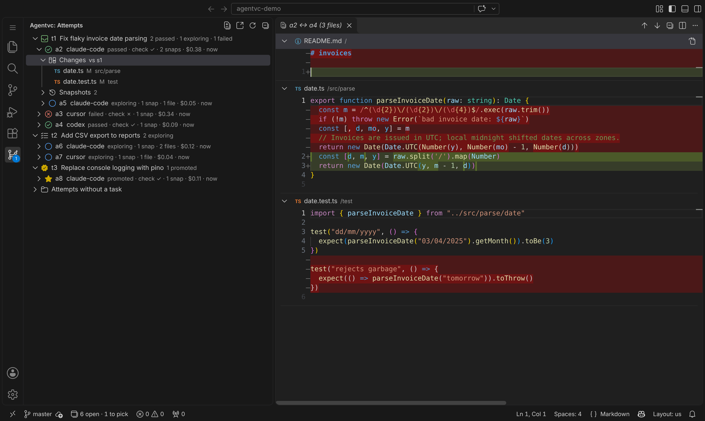

# agentvc for VS Code and Cursor

Review agent attempts without leaving the editor: see every task's attempt
tree, compare attempts in VS Code's native diff editor, and pick the winner.



## Features

- **Attempts view** (activity bar): tasks → attempts, nested by what they were
  forked from, with status, actor, check result, snapshot count, cost and a
  spinner for live runs. Each attempt lists its changed files and snapshots.
  The view's badge counts tasks ready to pick a winner.
- **Compare** in the native diff editor: an attempt against its fork point,
  any two attempts (`agentvc: Compare Two Attempts…`, or *Select for Compare* /
  *Compare with Selected*), or a snapshot against the one before it. Added and
  removed files show against an empty side. Uses the multi-file diff editor
  where available, and falls back to a file picker.
- **Actions**: open an attempt's view in a new window or add it to the
  workspace, fork, mark passed / failed, promote (pick the winner; the task's
  other open attempts are abandoned, exactly like `agentvc promote`), abandon
  with a reason, stop a live run, open a pull request (`agentvc pr`), and open
  the attempt in the web review UI.
- **Status bar**: in a window opened on an attempt's view, shows that attempt
  and its last snapshot; elsewhere, how many attempts are open and how many
  tasks are ready to pick.
- **Live**: the tree follows `agentvcd`'s event stream, so it updates as agents
  snapshot. While runs are alive, the live board is polled every 3 s.

## How it connects

1. `agentvc.daemonUrl` (default `http://127.0.0.1:7420`), if a daemon there
   serves this workspace's space.
2. Otherwise it starts `agentvcd --port 0` for the workspace
   (`agentvc.autoStartDaemon`, on by default) and stops it on exit.
3. Otherwise it falls back to the `agentvc` CLI with `--json`. The tree and
   review actions work; diffs read attempts' current views, and snapshots,
   stopping runs and the web UI need the daemon.

Fork and pull requests always run the CLI (`agentvc.cliPath`).

## Settings

| Setting | Default | |
| --- | --- | --- |
| `agentvc.daemonUrl` | `http://127.0.0.1:7420` | Daemon to use when it serves this space |
| `agentvc.autoStartDaemon` | `true` | Start `agentvcd` when none answers |
| `agentvc.cliPath` | `agentvc` | CLI for fork, PRs and the fallback |
| `agentvc.daemonPath` | `agentvcd` | Daemon binary to start |
| `agentvc.forkActor` | `human` | Actor recorded on forks from the editor |
| `agentvc.confirmPromote` | `true` | Ask before promoting |

## Requirements

The `agentvc` CLI and the `agentvcd` daemon on `PATH` (or set
`agentvc.cliPath` and `agentvc.daemonPath`), and a repository set up with
`agentvc init`.

## Install

From the VS Code Marketplace (VS Code) or Open VSX (Cursor, VSCodium): search
for **agentvc**, or

```sh
code --install-extension agentvc.agentvc
```

Or download `agentvc.vsix` from a GitHub Release or a CI run, then
*Extensions → … → Install from VSIX…*, or `cursor --install-extension agentvc.vsix`.

## Release

Push a tag `vscode-vX.Y.Z`. The *VS Code extension release* workflow tests,
packages and publishes to the Marketplace (`VSCE_PAT` secret) and Open VSX
(`OVSX_PAT` secret), and attaches the `.vsix` to a GitHub Release. Add the
version's notes to `CHANGELOG.md` first.

## Develop

```sh
cd integrations/vscode
npm ci
npm run build          # bundle to dist/extension.js
npm run test:unit      # model and client tests in plain Node
cargo build -p agentvc-cli -p agentvcd   # from the repo root, for the next step
npm test               # extension tests in VS Code via @vscode/test-electron
npm run package        # agentvc.vsix
```

Press F5 with this folder open to launch an Extension Development Host. The
daemon's types are shared with the web UI (`ui/src/api/types.ts`).

## License

MIT OR Apache-2.0, at your option.
