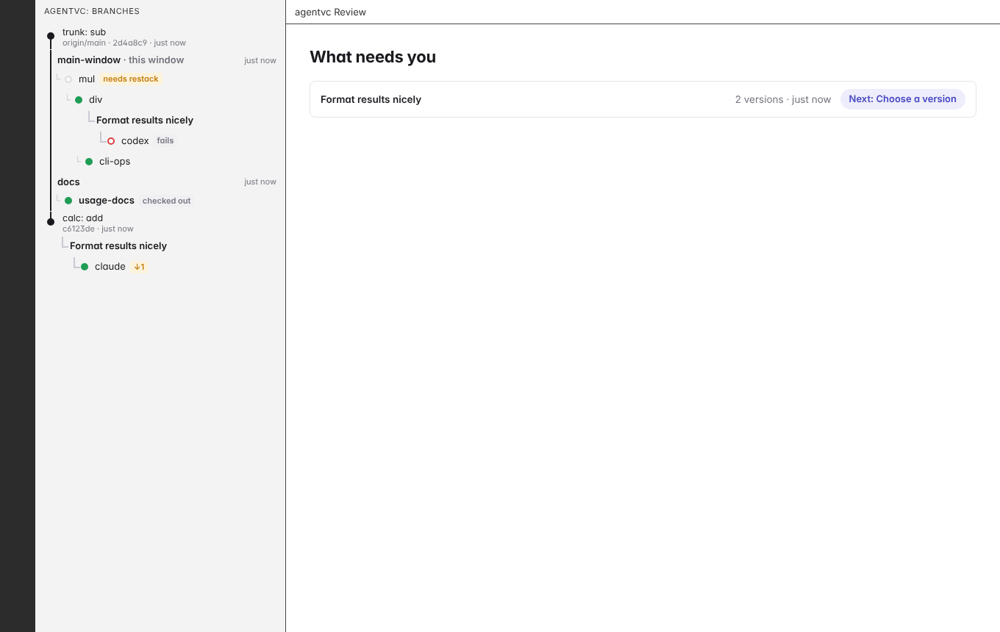

# agentvc for VS Code and Cursor

Review agent work without leaving the editor: one tree of main, every
window's stack and every agent's versions; move things by dragging, settle
clashes in place, compare in VS Code's native diff editor, and pick the winner.



## Features

- **Branches** (side bar) and **agentvc Review** (editor tab): the same review
  UI as the browser, served by `agentvcd` and shown in a frame, so VS Code,
  Cursor and the web look and work the same. The side bar is one tree: main,
  each window's stack of branches (every worktree, every editor window has its
  own; this window first), and every task's versions under the commit, branch
  or version they are based on. Drag a version onto a main commit to rebase
  it, or onto another version to stack it on top; drag a branch onto another
  branch or onto main to move it, wherever that window is (the change waits
  while an agent works there). Click anything to open it in the review tab,
  with the rebase preview, conflict resolver, Open PR and Undo; double-click a
  branch to check it out. When a move or restack clashes, the branch page shows
  each place with Keep main / Keep mine / Keep both / Edit, then *Continue* or
  *Abort*. The frame follows the editor's theme. Needs the daemon (started for
  you). In a remote window the daemon's port is forwarded with
  `asExternalUri`; the daemon answers only `localhost`, so this works for SSH
  and dev containers that forward to localhost.
- **Stack commands** (command palette, `agentvc stack`): new branch, amend,
  commit, sync with trunk, submit (push and one PR per branch), restack, track
  an existing branch, up/down/top/bottom. They act on this window's worktree
  only (see [docs/stacks.md](../../docs/stacks.md)) and need only the
  `agentvc` CLI. The status bar shows the current branch, its place in the
  stack, and how many branches need a restack.
- **Compare** in the native diff editor: an attempt against its fork point,
  or any two attempts (`agentvc: Compare Two Attempts…`). Added and
  removed files show against an empty side. Uses the multi-file diff editor
  where available, and falls back to a file picker.
- **Actions** (command palette): open an attempt's view in a new window or add it to the
  workspace, fork, mark passed / failed, promote (pick the winner; the task's
  other open attempts are abandoned, exactly like `agentvc promote`), abandon
  with a reason, stop a live run, open a pull request (`agentvc pr`), and open
  the attempt in the web review UI.
- **Status bar**: in a window opened on an attempt's view, shows that attempt
  and its last snapshot; elsewhere, how many attempts are open and how many
  tasks are ready to pick.
- **Live**: the tree follows `agentvcd`'s event stream, so it updates as agents
  snapshot.

## How it connects

1. `agentvc.daemonUrl` (default `http://127.0.0.1:7420`), if a daemon there
   serves this workspace's space.
2. Otherwise it starts `agentvcd --port 0` for the workspace
   (`agentvc.autoStartDaemon`, on by default) and stops it on exit.
3. Otherwise it falls back to the `agentvc` CLI with `--json`. The palette's
   review actions and compare work; diffs read attempts' current views, and
   the Branches tree, snapshots and stopping runs need the daemon.

Fork and pull requests always run the CLI (`agentvc.cliPath`).

## Settings

| Setting | Default | |
| --- | --- | --- |
| `agentvc.daemonUrl` | `http://127.0.0.1:7420` | Daemon to use when it serves this space |
| `agentvc.autoStartDaemon` | `true` | Start `agentvcd` when none answers |
| `agentvc.cliPath` | `agentvc` | CLI for fork, PRs and the fallback |
| `agentvc.daemonPath` | `agentvcd` | Daemon binary to start |
| `agentvc.forkActor` | `human` | Actor recorded on forks from the editor |
| `agentvc.confirmPromote` | `true` | Ask before promoting |

## Requirements

The `agentvc` CLI and the `agentvcd` daemon on `PATH` (or set
`agentvc.cliPath` and `agentvc.daemonPath`), and a repository set up with
`agentvc init`.

## Install

From the VS Code Marketplace (VS Code) or Open VSX (Cursor, VSCodium): search
for **agentvc**, or

```sh
code --install-extension avc.agentvc
```

Or download `agentvc.vsix` from a GitHub Release or a CI run, then
*Extensions → … → Install from VSIX…*, or `cursor --install-extension agentvc.vsix`.

## Release

Push a tag `vscode-vX.Y.Z`. The *VS Code extension release* workflow tests,
packages and publishes to the Marketplace (`VSCE_PAT` secret) and Open VSX
(`OVSX_PAT` secret), and attaches the `.vsix` to a GitHub Release. Add the
version's notes to `CHANGELOG.md` first.

## Develop

```sh
cd integrations/vscode
npm ci
npm run build          # bundle to dist/extension.js
npm run test:unit      # model and client tests in plain Node
cargo build -p agentvc-cli -p agentvcd   # from the repo root, for the next step
npm test               # extension tests in VS Code via @vscode/test-electron
npm run package        # agentvc.vsix
```

Press F5 with this folder open to launch an Extension Development Host. The
daemon's types are shared with the web UI (`ui/src/api/types.ts`).

## License

MIT OR Apache-2.0, at your option.
